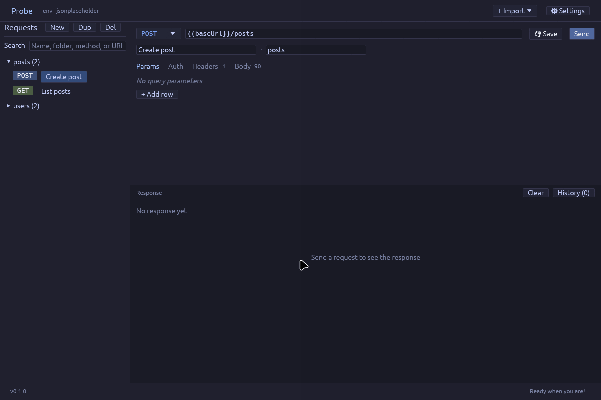
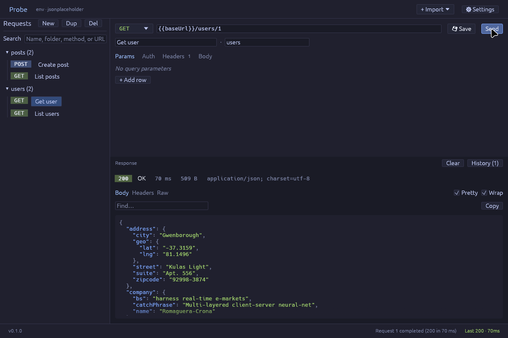
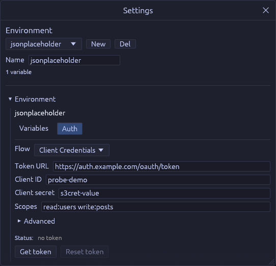

<div align="center">

# Probe

**A fast, native HTTP client — built with Rust and egui.**

No Electron, no account, no cloud sync. Your requests are plain `.http` files you can commit to git.




</div>

---

## Why Probe?

- **Native and light.** A single binary that starts instantly. Requests run on a background Tokio worker, so the UI never freezes.
- **Plain-text collections.** Every request is a `.http` file, the same format VS Code REST Client and JetBrains HTTP Client use. Diff them, review them, keep them next to your code.
- **Offline-first.** Everything lives in a local `./data` folder. Nothing leaves your machine except the requests you send.
- **Real OAuth 2.0.** Authorization Code + PKCE, Client Credentials and Device Code, with automatic token refresh and optional OS-keychain storage.

## Features

| | |
|---|---|
| **Requests** | Any method, query params, headers and body. Auth per request: Bearer, Basic, API key (header or query), or the environment's OAuth token. Organize requests in folders and search by name, folder, method or URL. |
| **Environments** | JetBrains-style `http-client.env.json`, plus `http-client.private.env.json` for secrets. Use `{{variable}}` anywhere in a request. |
| **Responses** | Status, timing, size and content type at a glance. Pretty-printed, syntax-highlighted JSON with find, wrap and copy. Headers and raw views. Per-request history. |
| **Import** | Paste a `curl` command straight into the URL bar. OpenAPI 3 and Swagger 2 from a file or URL, with a merge preview that keeps your edits. `.http` / `.rest` files. Whole Probe workspaces. |
| **Export** | Save the full workspace (requests, environments, history) as one bundle. Probe backs up your workspace before every import. |
| **Safety** | `Authorization`, cookies, API keys and proxy credentials are redacted in saved history. Closing with unsaved changes asks first. |
| **Updates** | Checks GitHub Releases once a day and updates itself in place, but only with releases signed by the maintainer's offline key. A compromised GitHub account or build pipeline can't push an update on its own. |

<p align="center">
  
</p>

## Getting started

### Download

Grab the latest build for your platform from the [Releases page](https://github.com/neisep/Probe/releases):

| Platform | File |
|---|---|
| Linux x86_64 | `probe-linux-x86_64` |
| Windows x86_64 | `probe-windows-x86_64.exe` |

On Linux, make it executable first: `chmod +x probe-linux-x86_64`.

Probe keeps its data in `./data` **relative to the folder you start it from**, so start it from the folder you want as your workspace.

### Build from source

You need a recent stable Rust toolchain. On Debian/Ubuntu, install the system libraries first:

```sh
sudo apt-get install libx11-dev libxinerama-dev libxcb-render0-dev \
  libxcb-shape0-dev libxcb-xfixes0-dev libxkbcommon-dev libgtk-3-dev
```

Then:

```sh
git clone https://github.com/neisep/Probe.git
cd Probe
cargo run --release
```

## Keyboard shortcuts

| Shortcut | Action |
|---|---|
| <kbd>Ctrl</kbd> + <kbd>Enter</kbd> | Review & send the selected request |
| <kbd>Ctrl</kbd> + <kbd>S</kbd> | Save all changes to disk |

On macOS, use <kbd>Cmd</kbd> instead of <kbd>Ctrl</kbd>.

## Where your data lives

| Path | Contents |
|---|---|
| `data/collections/<folder>/<name>.http` | Your requests |
| `data/http-client.env.json` | Environments and variables |
| `data/http-client.private.env.json` | Private variables (keep this out of git) |
| `data/.probe/` | Response history, session state, OAuth settings and tokens |
| `data/backups/` | Workspace snapshots taken before each import |

---

## OAuth 2.0



Each environment can have its own OAuth configuration. Open **Settings → Auth**, pick a flow, fill in the fields and click **Get token**.

| Flow | When to use |
|---|---|
| Authorization Code + PKCE | Interactive login. Opens your browser and handles the callback. |
| Client Credentials | Service-to-service, no user involved. |
| Device Code | Devices without a browser. Shows a code to enter elsewhere. |

**Required fields**

- **Authorization Code + PKCE:** authorize URL, token URL, client ID. Client secret only for confidential clients.
- **Client Credentials:** token URL, client ID, client secret.
- **Device Code:** device authorization URL, token URL, client ID.

Scopes are space-separated (e.g. `openid profile email`). The **Advanced** section adds `audience`, `resource` and any extra parameters.

<br clear="right">

### Token lifecycle

- Before each request Probe checks the token. If it's about to expire, it refreshes it with the refresh token. For Client Credentials, it simply requests a new token, no user step needed.
- If the server doesn't say how long a token lasts, Probe reads the expiry from the JWT's `exp` claim.
- The request's **Auth** tab shows what will happen on send: `expires in …`, `renews on send`, `expired` or `no token`.
- **Reset token** clears the stored token for the active environment.

### Header injection

By default the token is sent as `Authorization: Bearer <token>`. Under **Header injection** you can change the header name and prefix (leave the prefix blank for a raw token), or turn injection off without deleting the token. A header you set yourself on a request is never overwritten.

### Keychain storage (optional)

Tokens are stored under `data/.probe/oauth_tokens/` by default. Build with `keyring-storage` to keep them in the OS keychain instead (macOS Keychain, Windows Credential Manager, Linux Secret Service):

```sh
cargo build --release --features keyring-storage
```

---

## Development

```sh
cargo test     # run the test suite
cargo clippy   # lint
cargo fmt      # format
```

Releases are built by GitHub Actions when a `vX.Y.Z` tag is pushed. The tag *is* the version: it's compiled into the binary, so there's no version to bump in `Cargo.toml`. Local builds show up as `-dev` and never update themselves. CI only creates a draft; the maintainer signs and publishes it. See [docs/RELEASING.md](docs/RELEASING.md).
